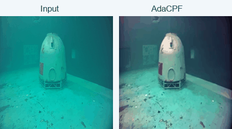
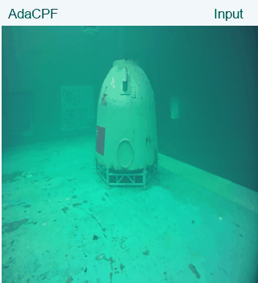
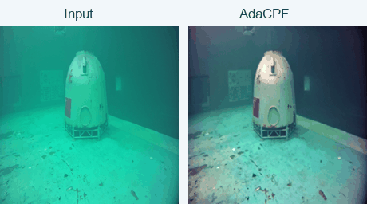
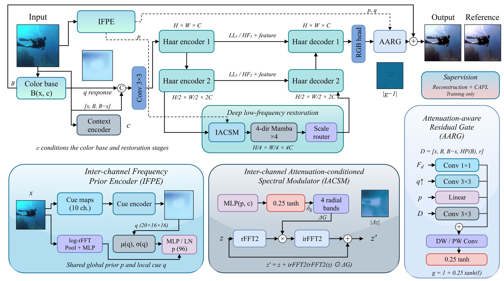
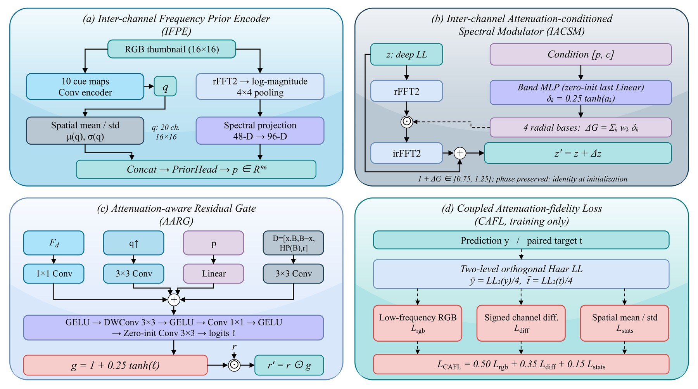
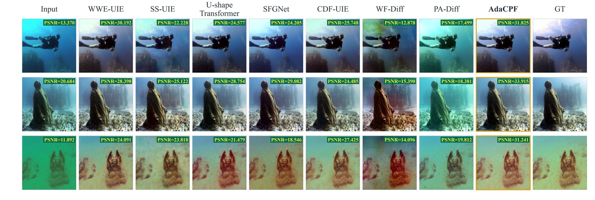
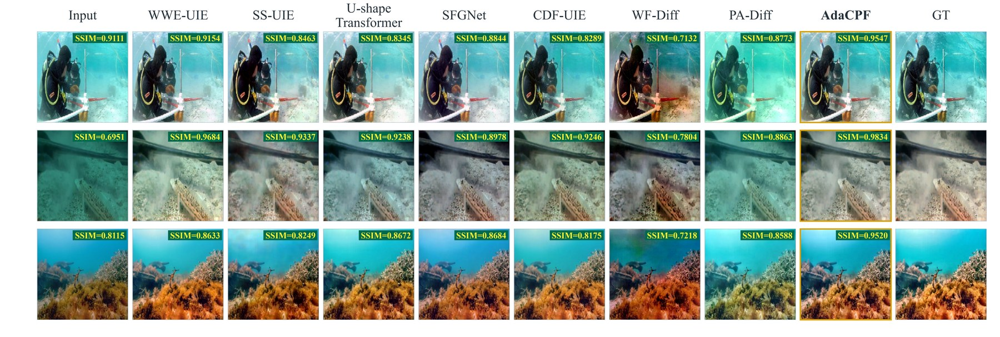
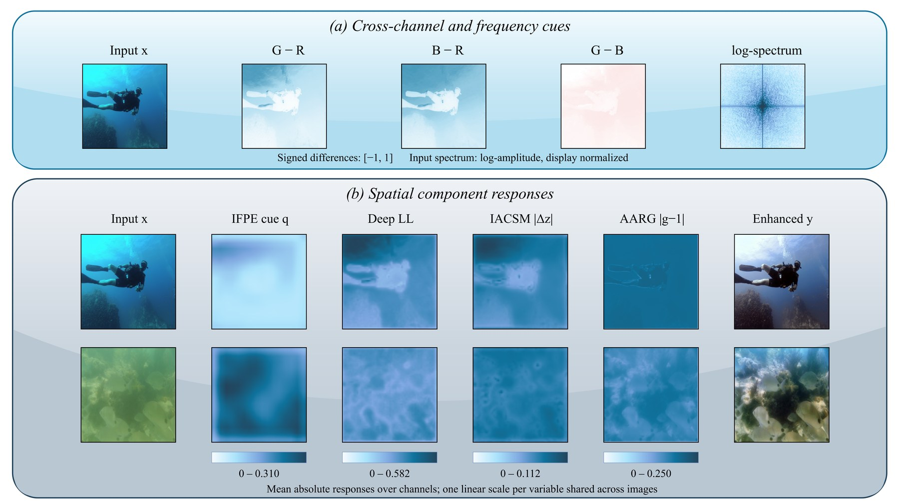
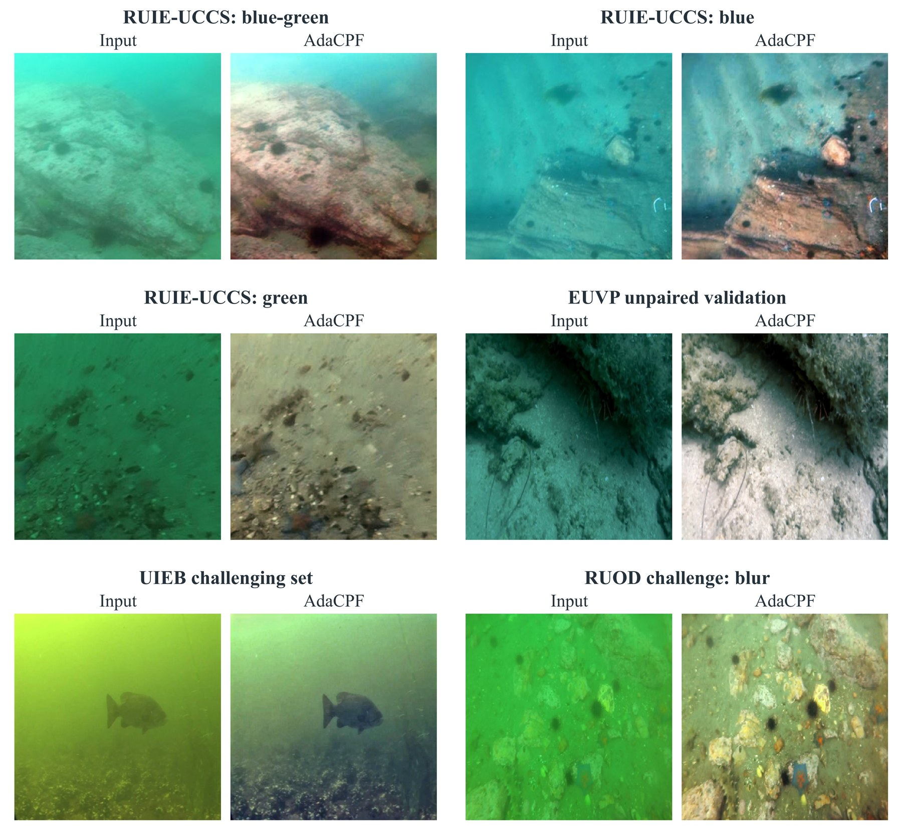

# AdaCPF
### Cross-Channel Priors for Adaptive Underwater Image Enhancement

**Shared degradation cues · Adaptive color and detail recovery · Embedded underwater vision**

[TeleAI Water-related Embodied AI Group](https://teleloong.github.io/teleai_weai/)

[Video demo](#-underwater-video-demo) · [Method](#-method) · [Visual results](#-visual-results) · [Deployment](#-camera-deployment) · [Acknowledgements](#-acknowledgements)

*Input and AdaCPF enhancement from the same recorded underwater sequence.*

## ✨ Highlights

- **Shared cross-channel priors.** Color differences, spatial statistics and frequency cues provide input-dependent restoration guidance.
- **Adaptive enhancement.** Low-frequency spectral modulation and spatial residual gating coordinate global color correction with local detail recovery.
- **Compact inference model.** 2.501 million parameters.
- **Camera deployment.** Evaluated on an embedded Jetson Orin NX SUPER 16 GB with complete-video processing at a median of **19.080 FPS** over three runs.

## 🌊 Underwater video demo

[▶ View or download the enhanced video](video/underwater_demo.mp4)

The GIF samples corresponding frames from the original recording and the final enhanced video at approximately 6 frames per second for compact web playback. The full video contains 473 frames at 256 × 256 output resolution. Saved-video playback rate and measured processing throughput are separate quantities.

### Color and detail

*A moving divider compares the same fixed frame: AdaCPF on the left, input on the right.*

### Across the sequence

*Six corresponding input/output pairs sampled across the recorded sequence.*

## 🧠 Method

IFPE extracts shared degradation cues from the input image. IACSM conditions low-frequency spectral modulation, while AARG controls residual corrections across positions and channels. CAFL guides color fidelity during training.

### Overall framework

### Core modules

## 📷 Visual results

| Comparison | Preview |
|:--|:--|
| Paired visual comparison | [Open full image](figures/visual_comparison_1.jpg) |
| Additional visual comparison | [Open full image](figures/visual_comparison_2.jpg) |
| Component responses | [Open full image](figures/feature_responses.jpg) |
| Real-world results | [Open full image](figures/real_world_results.jpg) |

More visual comparisons and component responses

## ⚙️ Camera deployment

AdaCPF was evaluated on a Jetson Orin NX SUPER 16 GB module integrated into the underwater camera. The recorded sequence was processed completely in three consecutive runs.

| Item | Setting / result |
|:--|:--|
| Compute module | Jetson Orin NX SUPER 16 GB |
| Network input / enhanced output | 160 × 160 / 256 × 256 |
| Video frames per run | 473 |
| Complete-video processing rates | 19.080 / 19.019 / 19.118 FPS |
| Median complete-video processing rate | 19.080 FPS |

Processing measurements include video decoding and encoding. The GIFs are visual previews of saved results.

## 🤝 Acknowledgements

This work was supported by:

- **The Institute of Artificial Intelligence (TeleAI), China Telecom, P. R. China.** Our team: [Water-related Embodied AI Group · 涉水具身智能团队](https://teleloong.github.io/teleai_weai/).
- **西北工业大学光电与智能研究院（iOPEN）, Xi’an 710072, China.**

<table>
<tr>
<td align="center" width="40%"></td>
<td align="center" width="60%"></td>
</tr>
<tr><td align="center">中国电信人工智能研究院（TeleAI）</td><td align="center">西北工业大学光电与智能研究院（iOPEN）</td></tr>
</table>

The logos link to the institutions’ official websites. The iOPEN mark is from its [official visual identity page](https://iopen.nwpu.edu.cn/yjygk/xxsb.htm).

## Repository contents

Framework illustrations, visual comparisons, GIF previews and an enhanced underwater video are provided here.

